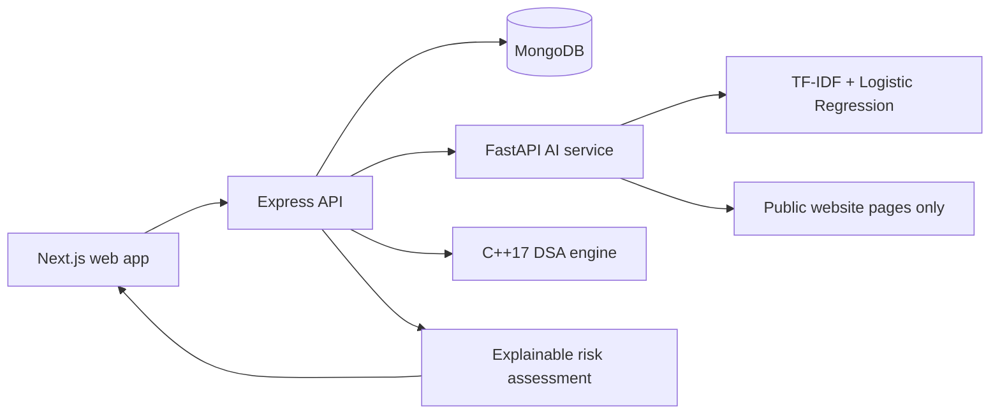

# InternGuard

> **Verify Before You Apply.**

InternGuard is an AI-assisted internship verification and fraud-risk screening platform designed as a Smart India Hackathon-style prototype. It helps students and institutional reviewers understand legitimate screening signals from company data, public websites, internship language, contact consistency, and platform reports.

> Automated screening is not a legal determination of fraud. A high screening score means that supporting evidence and manual verification deserve more attention.

## What is included

- Next.js App Router frontend in JavaScript, with responsive public, student, and verifier/admin screens.
- Express/MongoDB API with JWT authentication, role authorization, validation, rate limiting, security headers, auditing, seed data, and REST endpoints.
- FastAPI service using an explainable TF-IDF + Logistic Regression internship-language classifier, plus safe public-page website signals.
- C++17 JSON-in/JSON-out risk engine demonstrating Trie, hash maps, matching, binary search, sorting, priority queue, stack, queue, and a graph/BFS relationship model.
- Explainable multi-factor 0–100 prototype score, source-aware evidence signals, risk recommendations, and clear safety language.
- Docker Compose configuration, demo data, tests, environment templates, API documentation, and architecture notes.

## Architecture



## Project layout

```text
frontend/      Next.js App Router UI
backend/       Express API, Mongoose models, seed script
ai-service/    FastAPI NLP and public website analysis service
risk-engine/   C++17 JSON risk engine and CMake tests
docs/          Architecture, API, AI, data, security, and setup notes
```

## Quick start

Prerequisites: Node.js 20+, Python 3.11+, CMake and a C++17 compiler, and MongoDB 7+ (or Docker).

```bash
npm install
copy backend\.env.example backend\.env
copy frontend\.env.example frontend\.env.local
copy ai-service\.env.example ai-service\.env
python -m venv ai-service\.venv
ai-service\.venv\Scripts\activate
pip install -r ai-service\requirements.txt
npm run build:engine -w backend
```

Start MongoDB locally, then use separate terminals:

```bash
# terminal 1
cd ai-service
uvicorn app.main:app --reload --port 8000

# terminal 2
npm run seed
npm run dev
```

The web app runs at `http://localhost:3000`, the API at `http://localhost:8080`, and the AI service at `http://localhost:8000`.

### Docker

```bash
docker compose up --build
docker compose exec backend npm run seed
```

## Demo accounts

Run `npm run seed` first. All seed records are explicitly synthetic and must not be taken as data about real people or organizations.

| Role | Email | Development password |
| --- | --- | --- |
| Student | `student@demo.local` | `DemoOnly123!` |
| Admin | `admin@demo.local` | `DemoOnly123!` |
| Verifier | `verifier@demo.local` | `DemoOnly123!` |

Never deploy these credentials to a public environment.

## Risk methodology

The demonstration score is capped at 100 and combines these explainable prototype factors:

| Factor | Range |
| --- | ---: |
| Company verification | 0–30 |
| Website signals | 0–20 |
| Internship language | 0–25 |
| Report patterns | 0–20 |
| Identity/contact consistency | 0–5 |

`0–30` is **Low Risk**, `31–60` is **Medium Risk**, and `61–100` is **High Risk**. These are prototype rules, not government thresholds. Signals store their value, source, check time, confidence, and explanation.

## Core API

| Method | Endpoint | Description |
| --- | --- | --- |
| POST | `/api/auth/register` | Student/organization account registration |
| POST | `/api/auth/login` | JWT sign-in |
| GET | `/api/auth/me` | Current user |
| GET/POST | `/api/organizations` | Search/create organizations |
| GET/PUT | `/api/organizations/:id` | Organization profile/update |
| GET/POST | `/api/internships` | List/create internships |
| POST | `/api/verification/company` | Imported data match screening |
| POST | `/api/verification/website` | Public website signal analysis |
| POST | `/api/analysis/internship` | NLP text analysis |
| GET/POST | `/api/complaints` | Authenticated report management |
| POST | `/api/risk/assessment` | Authenticated unified assessment |
| GET | `/api/admin/dashboard` | Admin/verifier dashboard |

See [docs/api.md](docs/api.md) for full details.

## Verification principles and limitations

- A record not found in an imported dataset is labelled **manual verification recommended**, never “fraud.”
- Public website checks make modest unauthenticated requests, respect robots rules where retrievable, reject non-public hosts, and do not scan for vulnerabilities or access protected content.
- The supplied company registry and activity records are synthetic demonstration data. A production deployment must import authorized, authoritative source data and preserve its provenance.
- NLP detects language patterns; it cannot determine intent or establish facts about an organization.
- Human reviewers should check source context and evidence before taking any consequential action.

## Testing

```bash
npm test
cmake -S risk-engine -B risk-engine/build
cmake --build risk-engine/build
ctest --test-dir risk-engine/build
cd ai-service && pytest
```

## Security

The API uses Helmet, a narrow CORS allow list, rate limiting, JSON body limits, input validation, Mongo-style key rejection, bcrypt password hashing, JWT expiry, and role checks. Do not store secrets in source control. Copy the service-specific `.env.example` files and set unique production secrets.

See [docs/setup.md](docs/setup.md), [docs/security.md](docs/security.md), and [docs/architecture.md](docs/architecture.md) for deployment notes and design details.
