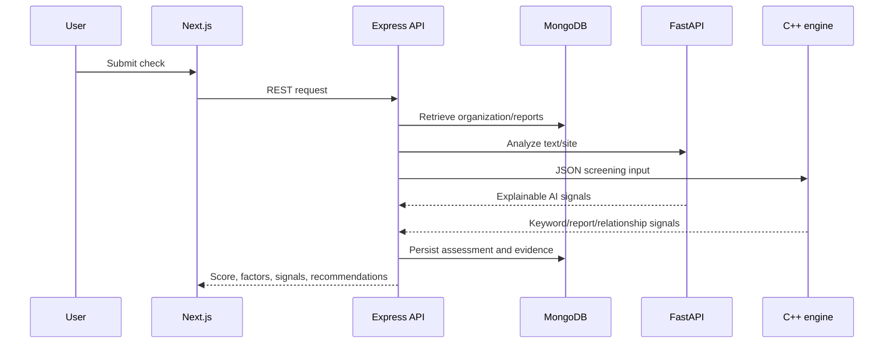

# Architecture

InternGuard is a four-service local architecture: Next.js renders the user interface; Express coordinates identity, persistence, validation, scoring, and audit events; FastAPI supplies explainable ML/public-page signals; and a C++ process supplies deterministic DSA signals over a stable JSON contract.

The Express service is intentionally resilient: if the local C++ executable or AI service is unavailable, it records a labelled fallback result rather than failing silently. Production operations should monitor those fallbacks and fix the underlying dependency.

All scores are screening signals, not legal fraud determinations.
